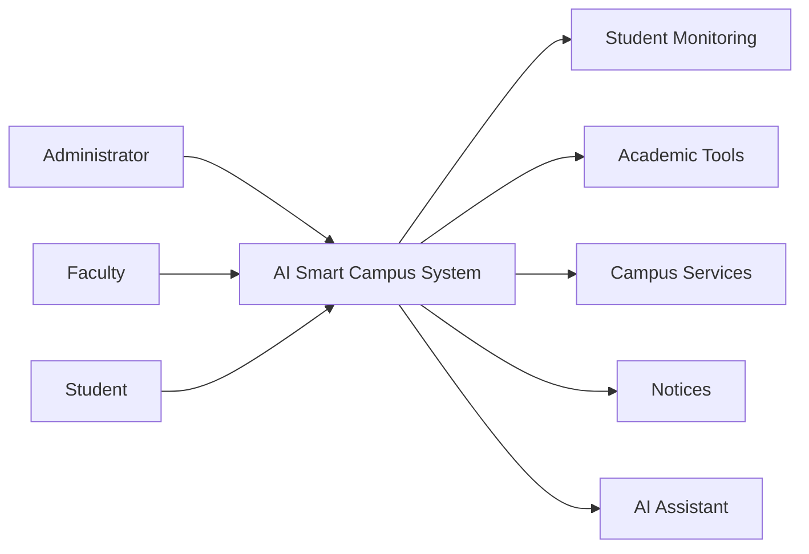

# AI Smart Campus System

  <strong>A role-based university management platform for administrators, faculty, and students.</strong>
   
  Student monitoring, academic tools, campus services, notices, and an AI assistant in one connected experience.

  <a href="https://ai-smart-campus-system-ce9i.onrender.com"><strong>Explore the Live Demo</strong></a>

  
  
  
  

---

## Overview

AI Smart Campus System is designed to bring common university workflows into a clear, role-aware platform. It supports the day-to-day needs of administrators, faculty members, and students while keeping academic information, campus services, notices, and intelligent assistance easy to access.

## Live Demo

Try the deployed application: [ai-smart-campus-system-ce9i.onrender.com](https://ai-smart-campus-system-ce9i.onrender.com)

> The demo is hosted on Render and may take a moment to wake up after inactivity.

## What the platform includes

| Area | Capabilities |
| --- | --- |
| Role-based access | Dedicated experiences for administrators, faculty, and students |
| Student support | Student monitoring and academic tools |
| Campus operations | Campus services and notice-management workflows |
| AI assistance | An AI assistant for campus-related support |
| Interface | Responsive, professional web experience |

## Role flow

## Technology stack

- **Backend:** Laravel
- **Frontend:** Vue.js
- **Database:** MySQL
- **Integration:** REST API

## Project source note

This repository is a public project showcase. The main production source repository is private to protect the project code and deployment configuration.

## Contact

**MD. Nazmus Shakib**  
Phone: 01716333670
